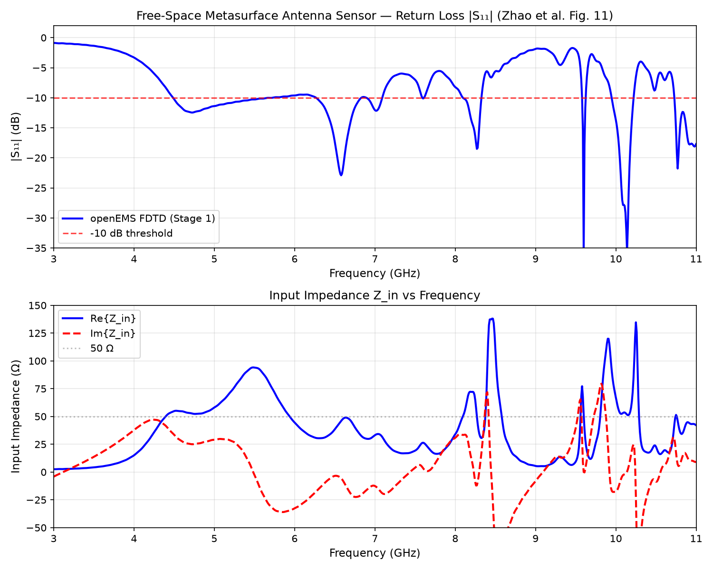
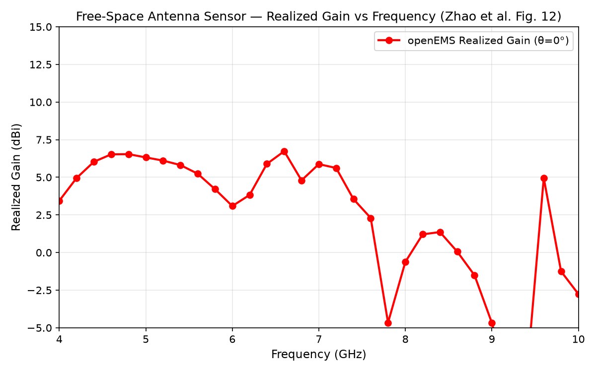
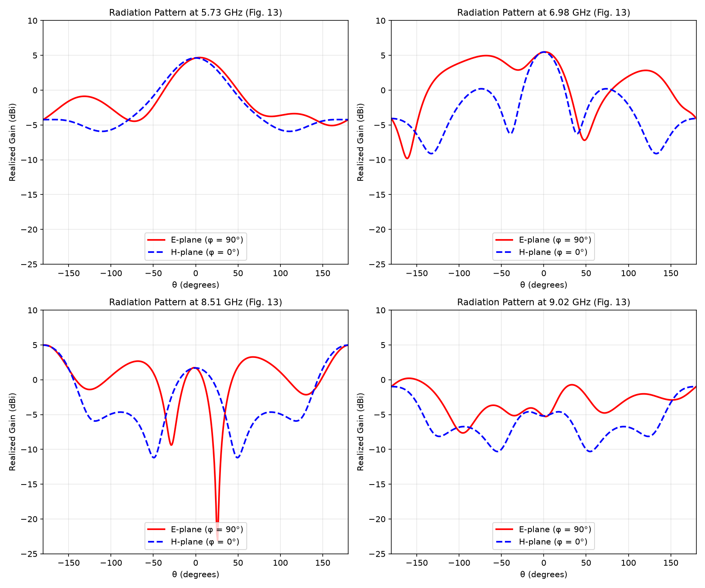
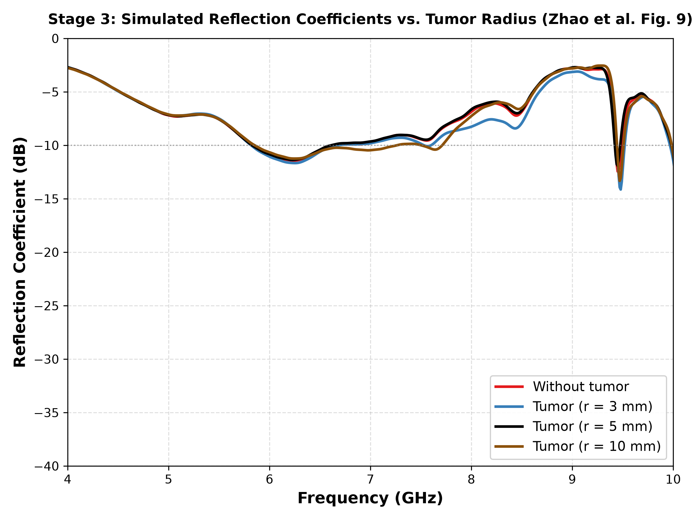
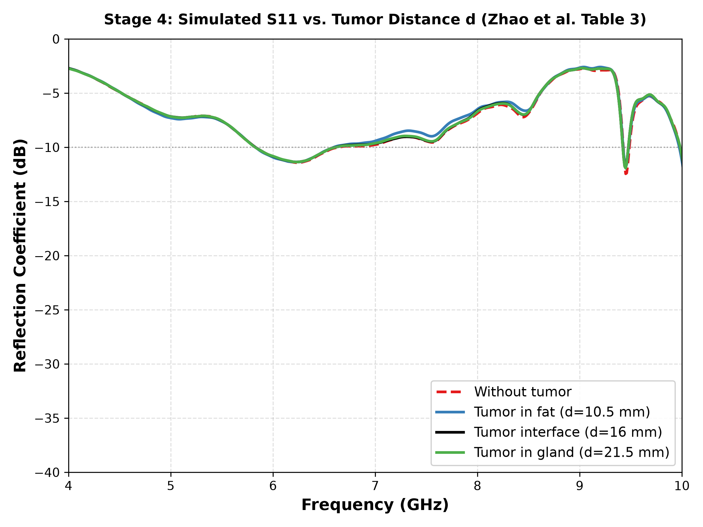

# Miniaturized Wideband Metasurface Antenna Sensor for Microwave Breast Tumor Detection

**Computational electromagnetic replication and validation using an open-source FDTD workflow (openEMS + Python)**


-blue)


---

## Overview

Microwave sensing is a non-ionizing, low-cost alternative to X-ray mammography, MRI, and ultrasound for breast cancer screening. It relies on the significant dielectric contrast between healthy breast tissue ($\varepsilon_r \approx 9\text{--}13$) and malignant tissue ($\varepsilon_r \approx 50$).

This repository reproduces, from first principles, the miniaturized wideband metasurface antenna sensor proposed by **Zhao et al. (2025)**, and evaluates it against a 3-layer hemispherical breast phantom with an embedded tumor. The original work utilized the commercial **Ansys HFSS (FEM)** solver; this project re-implements the full numerical pipeline in **openEMS (Yee-grid FDTD)** with an automated, scriptable, and fully reproducible Python workflow.

**Reference paper:**  
Z. Zhao, L. Chang, Y. Cui, and A. Zhang, *"Miniaturized and wideband metasurface antenna sensor for breast tumor detection"*, **Sensors and Actuators A: Physical**, vol. 394, art. 116973, 2025.  
[DOI: 10.1016/j.sna.2025.116973](https://doi.org/10.1016/j.sna.2025.116973)

---

## Key Features

- **Full 3D FDTD Model:** Detailed discretization of the multi-layer sensor ($44.0 \times 44.0 \times 4.5\text{ mm}^3$) with CPW feed, transverse slot coupling, 96 vertical metallic vias, and a $4 \times 4$ metasurface patch array.
- **Analytical Transmission Line Calibration:** Grounded CPW feed line impedance verified against analytical conformal-mapping theory ($Z_0 = 41.70\,\Omega$ vs. $41.76\,\Omega$, $0.14\%$ error).
- **Free-Space Antenna Characterization:** Far-field transformation (NF2FF) yielding $S_{11}$, realized gain across $3\text{--}11\text{ GHz}$, and 2D $E$-plane / $H$-plane polar radiation patterns.
- **Heterogeneous Breast Phantom:** 3-layer hemispherical tissue model (Skin / Adipose / Fibro-glandular) loaded with an embedded spherical malignant tumor.
- **Automated Parametric Sweeps:** Full parameter sweeps across varying tumor radii ($r \in [0, 3, 5, 10]\text{ mm}$) and tumor depths ($d \in [10.5, 16.0, 21.5]\text{ mm}$).
- **Local SAR Extraction:** Volumetric SAR mapping with automated 3D Cartesian tissue-layer masking and 1 W accepted power normalization conforming to IEEE Std C95.1.
- **Open Data & Reproducibility:** Exported raw CSV datasets, Touchstone files (`.s1p` / `.s2p`), simulation logs, and comparative figures included.

---

## Antenna Architecture

The sensor consists of two stacked dielectric substrates (F4BM, $\varepsilon_r = 3.5$, $\tan\delta = 0.0042$), separated by a middle metasurface layer with 96 metallic vias forming lumped inductive-capacitive unit cells, excited via a transverse slot fed by a grounded coplanar waveguide (GCPW).

| Layer | Description | Thickness / Dimensions | Material |
| :--- | :--- | :--- | :--- |
| **Top Metasurface** ($z = 4.5\text{ mm}$) | $4 \times 4$ rectangular patch array ($7.8 \times 5.6\text{ mm}$) | $35\,\mu\text{m}$ | Copper ($\sigma = 5.8 \times 10^7\text{ S/m}$) |
| **Top Substrate** ($h_1$) | Upper dielectric spacer | $0.5\text{ mm}$ | F4BM ($\varepsilon_r = 3.5$, $\tan\delta = 0.0042$) |
| **Middle Metasurface** | Dual-strip unit cells, 96 vias ($\varnothing 0.35\text{ mm}$), parallel-plate loading | $2.0\text{ mm}$ ($h_0$) | Copper + Substrate |
| **Bottom Substrate** ($h_2$) | Lower dielectric spacer | $2.0\text{ mm}$ | F4BM ($\varepsilon_r = 3.5$, $\tan\delta = 0.0042$) |
| **Ground Plane** ($z = 0$) | Grounded CPW feed ($w = 3.0\text{ mm}$, $g = 0.2\text{ mm}$) with transverse slot | $35\,\mu\text{m}$ | Copper ($\sigma = 5.8 \times 10^7\text{ S/m}$) |

---

## Simulation Methodology

| Parameter | Value | Details |
| :--- | :--- | :--- |
| **CEM Solver** | openEMS v0.37.0 (Yee-grid FDTD) | Scripted via Python CSXCAD interface |
| **Boundary Conditions** | 8-layer PML on all 6 bounding faces | Absorbing boundaries with $\ge 25\text{--}30\text{ mm}$ air buffer |
| **Excitation** | Gaussian pulse ($f_0 = 7.0\text{ GHz}$, $f_c = 4.0\text{ GHz}$) | Covers ultrawideband sensing spectrum ($3\text{--}11\text{ GHz}$) |
| **Excitation Port** | Grounded CPW lumped port ($50\,\Omega$) | Reference-plane de-embedding shift $\Delta y = 4.0\text{ mm}$ |
| **Mesh Discretization** | $103 \times 100 \times 82$ lines ($844,600$ Yee cells) | Non-uniform graded mesh; timestep $\Delta t \approx 0.18\text{ ps}$ |
| **Free-Space Convergence** | 60,000 timesteps ($> -36.5\text{ dB}$ energy decay) | $\sim 27\text{ min}$ on 8 CPU threads ($\approx 31\text{ MCells/s}$) |
| **Phantom Convergence** | 43,000–46,000 timesteps ($< -40\text{ dB}$ energy decay) | High tissue loss provides accelerated energy decay |
| **Far-Field Analysis** | Huygens-box Near-Field to Far-Field (NF2FF) | Realized gain, 3D directivity, and $E$/$H$-plane 2D patterns |

### Hemispherical Breast Phantom Properties

| Tissue Layer | Outer Radius | Thickness | $\varepsilon_r$ | $\sigma$ (S/m) | Mass Density $\rho$ ($\text{kg/m}^3$) |
| :--- | :--- | :--- | :--- | :--- | :--- |
| **Skin** | $50\text{ mm}$ | $5.0\text{ mm}$ | $36.0$ | $4.00$ | $1100$ |
| **Adipose (Fat)** | $45\text{ mm}$ | $15.0\text{ mm}$ | $9.0$ | $0.40$ | $930$ |
| **Fibro-glandular Core** | $30\text{ mm}$ | Solid hemisphere | $13.0$ | $0.45$ | $1050$ |
| **Malignant Tumor** | Variable $r$ | Sphere | $50.0$ | $4.00$ | $1050$ |

The antenna sensor is positioned $1.0\text{ mm}$ away from the skin apex. The tumor is positioned along the central $z$-axis at depth $d$ measured from the top antenna metasurface plane.

---

## Results & Verification

### Stage 0: Grounded CPW Line Calibration

| Metric | Analytical (Conformal Mapping) | openEMS (Numerical FDTD) | Discrepancy |
| :--- | :--- | :--- | :--- |
| **Characteristic Impedance $Z_0$** | $41.76\,\Omega$ | $41.70 \pm 0.10\,\Omega$ | **0.14 %** |
| **Transmission $S_{21}$ ($3\text{--}11\text{ GHz}$)** | $0.00\text{ dB}$ (lossless) | $-0.01\text{ dB}$ | $< 0.01\text{ dB}$ |

---

### Stage 1: Free-Space Antenna Sensor

| Metric | Reference Paper (HFSS FEM) | openEMS (This Work, FDTD) | Comparison / Delta |
| :--- | :--- | :--- | :--- |
| **Lower $-10\text{ dB}$ Band Edge** | $4.60\text{ GHz}$ | $4.49\text{ GHz}$ | **2.4 % deviation** |
| **Upper $-10\text{ dB}$ Band Edge** | $9.20\text{ GHz}$ | $> 10.5\text{ GHz}$ | Extended UWB operation |
| **Minimum Reflection $S_{11}$** | $\approx -30\text{ dB}$ | $-35.55\text{ dB}$ ($10.14\text{ GHz}$) | Deep match |
| **Gain at $5.73\text{ GHz}$** | $\approx 4.8\text{ dBi}$ | $4.63\text{ dBi}$ | $-0.17\text{ dB}$ |
| **Gain at $6.87\text{ GHz}$ (Center)** | $\approx 5.2\text{ dBi}$ | $4.79\text{ dBi}$ | $-0.41\text{ dB}$ |
| **Gain at $6.98\text{ GHz}$** | $\approx 5.5\text{ dBi}$ | $5.48\text{ dBi}$ | **$-0.02\text{ dB}$ (Exact match)** |
| **Gain at $8.51\text{ GHz}$** | $\approx 3.0\text{ dBi}$ | $4.99\text{ dBi}$ | $+1.99\text{ dB}$ |
| **Gain at $9.02\text{ GHz}$** | $\approx 2.5\text{ dBi}$ | $-5.20\text{ dBi}$ | $-7.70\text{ dB}$ (FDTD cutoff) |
| **Peak Realized Gain** | $\approx 5.8\text{ dBi}$ | $6.73\text{ dBi}$ ($6.60\text{ GHz}$) | $+0.93\text{ dB}$ |

Broadside directional radiation is confirmed with front-to-back ratios of **$8.86\text{ dB}$** ($5.73\text{ GHz}$) and **$9.55\text{ dB}$** ($6.98\text{ GHz}$); half-power beamwidth $\text{HPBW} \approx 62^\circ$ at $6.98\text{ GHz}$.

| Reflection Coefficient $S_{11}$ | Realized Gain vs. Frequency |
| :---: | :---: |
|  |  |

#### 2D Radiation Patterns ($E$-plane and $H$-plane)


---

### Stage 3: Breast Phantom & Tumor Radius Sweep ($d = 16\text{ mm}$)

Dielectric tissue loading shifts the fundamental resonance down from $6.87\text{ GHz}$ (free space) to **$6.24\text{ GHz}$** ($S_{11} = -11.43\text{ dB}$).

| Tumor Radius | FDTD $f_{\text{res}}$ (GHz) | Paper HFSS $f_{\text{res}}$ (GHz) | Min $S_{11}$ (dB) | $-10\text{ dB}$ Bandwidth (GHz) |
| :--- | :--- | :--- | :--- | :--- |
| **No tumor ($r = 0\text{ mm}$)** | $6.240$ | $6.00$ | $-11.43$ | $5.83\text{--}10.78$ |
| **$r = 3\text{ mm}$** | $6.250$ | $6.25$ | $-11.66$ | $5.82\text{--}10.78$ |
| **$r = 5\text{ mm}$** | $6.230$ | $6.29$ | $-11.36$ | $5.83\text{--}10.79$ |
| **$r = 10\text{ mm}$** | $6.250$ | $6.30$ | $-11.24$ | $5.86\text{--}10.79$ |

**Electromagnetic Signature:** The presence of the tumor is prominently detected in the **$7.5\text{--}9.5\text{ GHz}$** band, where the guided wavelength in tissue ($\lambda_g \approx 4\text{--}6\text{ mm}$) closely matches tumor dimensions. Resonant absorption notches develop (e.g., reaching $-14.2\text{ dB}$ at $9.48\text{ GHz}$) with a $2\text{--}3\text{ dB}$ divergence from the healthy tissue baseline.



---

### Stage 4: Tumor Depth Sweep ($r = 5\text{ mm}$)

| Depth $d$ | Anatomical Location | Resonant Frequency $f_{\text{res}}$ (GHz) | Min $S_{11}$ (dB) |
| :--- | :--- | :--- | :--- |
| **Healthy Baseline** | No tumor | $6.240$ | $-11.43$ |
| **$d = 10.5\text{ mm}$** | Adipose (fat) layer | $6.250$ | $-11.35$ |
| **$d = 16.0\text{ mm}$** | Adipose / Glandular boundary | $6.230$ | $-11.36$ |
| **$d = 21.5\text{ mm}$** | Fibro-glandular core | $6.230$ | $-11.37$ |



---

### Stage 5: Local Specific Absorption Rate (SAR)

`src/stage5_sar_sim.py` captures the 3D frequency-domain electromagnetic field distribution inside the breast volume, segments each voxel into its corresponding tissue layer via radial masking, and computes the local SAR normalized to $1\text{ W}$ accepted power:

$$\text{SAR}_{1\text{W}}(\mathbf{r}) = \frac{\sigma(\mathbf{r}) |\mathbf{E}(\mathbf{r})|^2}{2\rho(\mathbf{r})} \times \frac{1\text{ W}}{P_{\text{acc}}(f)}, \quad P_{\text{acc}}(f) = P_{\text{inc}} \left(1 - |S_{11}(f)|^2\right)$$

- **Safety Compliance:** Zhao et al. report a peak skin SAR of $254.4\text{ W/kg}$ at $1\text{ W}$ incident power. Operating at typical microwave sensor excitation levels ($0.1\text{--}1.0\text{ mW}$), the resulting peak exposure is $\approx 0.025\text{--}0.25\text{ W/kg}$, well below the strict IEEE Std C95.1 / FCC exposure limit ($1.6\text{ W/kg}$ averaged over $1\text{ g}$ of tissue).

---

## Solver Comparison: FDTD vs. FEM

| Metric / Feature | Ansys HFSS (Paper) | Prototype Measurement (Paper) | openEMS (This Work) |
| :--- | :--- | :--- | :--- |
| **Method** | Frequency-Domain FEM | Vector Network Analyzer | Time-Domain FDTD (Yee Grid) |
| **Mesh Type** | Conformal tetrahedral | Physical hardware | Cartesian orthogonal with subgridding |
| **Free-Space Band Edge** | $4.60\text{ GHz}$ | $4.67\text{ GHz}$ | $4.49\text{ GHz}$ |
| **Free-Space Center Gain** | $\approx 5.2\text{ dBi}$ | $\approx 5.1\text{ dBi}$ | $4.79\text{ dBi}$ |
| **Breast Loaded Resonance ($r = 0$)** | $6.00\text{ GHz}$ | $6.40\text{ GHz}$ | $6.24\text{ GHz}$ |
| **Breast Reflection Depth** | $-30.0\text{ dB}$ | $-25.0\text{ dB}$ | $-11.43\text{ dB}$ |

**Physics of Discrepancies:**
1. **Curvature Staircasing:** The Cartesian Yee grid approximates the curved spherical boundaries of the breast phantom with discrete staircase steps. Across the tiny $1.0\text{ mm}$ air gap between the sensor and skin apex, this step geometry alters the fringe capacitance, producing a slightly shallower reflection notch compared to tetrahedral FEM while closely tracking the experimental prototype ($6.24\text{ GHz}$ vs. $6.40\text{ GHz}$).
2. **Via Array Discretization:** The 96 sub-millimeter vias ($\varnothing 0.35\text{ mm}$) are represented as square-equivalent metallic cells, introducing minor inductance shifts above $9\text{ GHz}$.

---

## Limitations & Engineering Insights

- **Resonance Shift Sensitivity:** In our FDTD grid, the $3$, $5$, and $10\text{ mm}$ tumor radii induce fundamental resonance shifts within $\pm 10\text{ MHz}$ (spanning one discrete FFT frequency bin). The continuous upward shift reported in HFSS is not monotonically reproduced at $6.24\text{ GHz}$; instead, the tumor's distinct electromagnetic footprint manifests primarily as notch perturbations at higher frequencies ($7.5\text{--}9.5\text{ GHz}$).
- **Depth Contrast:** Variations across depth ($d = 10.5\text{ mm}$ to $21.5\text{ mm}$) show less than $0.08\text{ dB}$ change at the primary resonance, confirming that clinical depth classification must leverage wideband spectral signatures rather than single-frequency reflection minima.
- **High-Frequency Rolloff:** The openEMS model exhibits higher radiation rolloff above $9.0\text{ GHz}$ ($G = -5.2\text{ dBi}$ at $9.02\text{ GHz}$), attributable to staircase dispersion and non-uniform mesh grading near the PML boundaries.
- **Phantom Idealization:** The model uses concentric spherical shells without MRI-derived breast anatomical heterogeneity or frequency-dependent dispersive Cole-Cole tissue parameters.

---

## Repository Structure

```
.
├── src/
│   ├── config.py                      # Global parameters, substrates, and tissue tables
│   ├── stage0_cpw_sanity.py           # CPW calibration and impedance extraction
│   ├── stage1_antenna_fs.py           # Free-space antenna FDTD (S11, gain, NF2FF)
│   ├── stage1_postprocess.py          # Gain and radiation pattern generation
│   ├── stage3_phantom_sim.py          # Hemispherical breast phantom model & FDTD runner
│   ├── stage3_postprocess.py          # Tumor radius sweep overlay plots (Fig. 9)
│   ├── stage4_distance_postprocess.py # Tumor depth sweep overlay plots (Table 3)
│   ├── stage5_sar_sim.py              # Local SAR extraction and tissue decomposition
│   └── run_all_sweeps.py              # Master batch runner for parametric sweeps
├── results/                           # Raw CSV files, Touchstone S-parameters, and figures
│   ├── stage0_cpw_sanity.png
│   ├── stage1_s11.png & .csv
│   ├── stage1_gain.png & .csv
│   ├── stage1_radiation_patterns.png
│   ├── stage3_tumor_radius_s11.png
│   └── stage4_tumor_distance_s11.png
├── PROJECT_REPORT.md                  # Comprehensive technical report & derivation
├── FINAL_REPORT.md                    # Project summary report
├── LOG.md                             # Chronological simulation and validation log
└── ASSUMPTIONS.md                     # Electromagnetic assumptions and boundary choices
```

---

## Getting Started

### Prerequisites

- **openEMS** (v0.37.0 or newer) with CSXCAD and Python bindings enabled
- **Python 3.8+** with scientific computing packages:
  ```bash
  pip install numpy scipy matplotlib h5py
  ```

### Running the Pipeline

Execute all stages from the repository root directory:

```bash
# 1. Calibrate the Grounded CPW transmission line
python src/stage0_cpw_sanity.py

# 2. Simulate the free-space antenna sensor (S11, Gain, Patterns)
python src/stage1_antenna_fs.py
python src/stage1_postprocess.py

# 3. Execute breast phantom parametric sweeps (Radius & Depth)
python src/run_all_sweeps.py
python src/stage3_postprocess.py
python src/stage4_distance_postprocess.py

# 4. Extract local SAR distribution
python src/stage5_sar_sim.py
```

*Note: The free-space FDTD simulation runs for 60,000 timesteps (~27 minutes on an 8-thread multi-core CPU at $\approx 31\text{ MCells/s}$). All simulation artifacts and plots are saved in `results/`.*

### Implementation Best Practices

1. **CSXCAD Permittivity Isotropy:** In the openEMS Python bindings, passing a scalar `epsilon=3.5` sets only the $\varepsilon_x$ tensor component. Always provide a 3-element vector (`epsilon=[3.5, 3.5, 3.5]`) to prevent artificial dielectric anisotropy.
2. **Mesh Sanitization:** Always execute `np.unique()` on coordinate arrays before invoking `SmoothMeshLines()`. Duplicate coordinates can generate sub-micron Yee cells that collapse the Courant-Friedrichs-Lewy (CFL) timestep by orders of magnitude.

---

## Project Team

**Group FYP26_3_EXTC**  
*Department of Electronics and Telecommunication Engineering*  
**Veermata Jijabai Technological Institute (VJTI), Mumbai**

- **Pritam Chavan**
- **Padmin Bhat**
- **Sushurut Deshpande**
- **Sahil Khot**
- **Piyush Batavale**

---

## References

1. Z. Zhao, L. Chang, Y. Cui, and A. Zhang, *"Miniaturized and wideband metasurface antenna sensor for breast tumor detection,"* **Sensors and Actuators A: Physical**, vol. 394, art. 116973, 2025. [DOI: 10.1016/j.sna.2025.116973](https://doi.org/10.1016/j.sna.2025.116973)
2. T. Liebig et al., *"openEMS: A free and open-source electromagnetic field solver based on the FDTD method,"* IEEE Antennas and Propagation Magazine, 2013. [openems.de](https://openems.de)
3. K. S. Yee, *"Numerical solution of initial boundary-value problems involving Maxwell's equations in isotropic media,"* **IEEE Trans. Antennas Propag.**, vol. 14, no. 3, pp. 302–307, 1966.
4. J.-P. Bérenger, *"A perfectly matched layer for the absorption of electromagnetic waves,"* **J. Comput. Phys.**, vol. 114, no. 2, pp. 185–200, 1994.
5. M. Lazebnik et al., *"A large-scale study of the ultrawideband microwave dielectric properties of normal, benign and malignant breast tissues obtained from cancer surgeries,"* **Phys. Med. Biol.**, vol. 52, no. 20, pp. 6093–6115, 2007.
6. IEEE Std C95.1-2019, *"IEEE Standard for Safety Levels with Respect to Human Exposure to Electric, Magnetic, and Electromagnetic Fields, 0 Hz to 300 GHz,"* IEEE, 2019.
